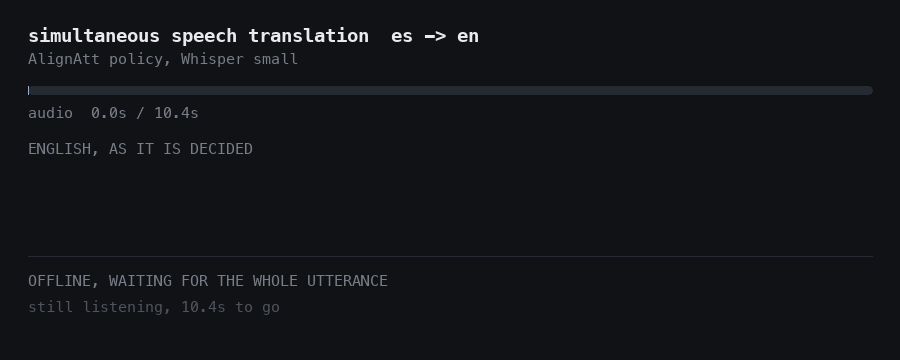

# Simultaneous Speech Translation, Spanish → English

English appears while the Spanish is still being spoken, and nothing on screen is ever
rewritten.



```bash
python -m simulst.live --mic                                 # talk to it
python -m simulst.live --file clip.wav --compare             # replay a recording
```

## What the hard part actually is

A simultaneous system is not a different model, it is a different *decision*: given half
an utterance, emit now and risk being wrong, or wait and accumulate lag. That decision is
inference-time logic, and this repository implements it rather than calling a library that
hides it.

The policy is **AlignAtt** (Papi et al., 2023). Generate greedily on the audio received so
far; for each candidate token, read which encoder frame its cross-attention points at. A
token leaning on the last `f` frames depends on sound that is still arriving, so it is
withheld. Everything else is committed permanently — which is why the measured revision
rate is **0.000 at every operating point**, and why the cost shows up as latency instead
of as text flickering in front of the reader.

## The result: a curve, not a score

`whisper-small`, 40 held-out utterances, 0.5 s chunks, one M1 Pro. `f` is the dial:

| Policy | BLEU | % of offline | Average Lagging | Revisions |
|---|---|---|---|---|
| Offline (wait for everything) | 25.90 | 100% | 6.59 s | 0.000 |
| AlignAtt `f=8` | 8.25 | 32% | **0.48 s** | 0.000 |
| AlignAtt `f=16` | 11.50 | 44% | 0.52 s | 0.000 |
| AlignAtt `f=32` | 13.88 | 54% | 1.09 s | 0.000 |
| AlignAtt `f=64` | 19.96 | 77% | 1.75 s | 0.000 |
| **AlignAtt `f=100`** | **24.04** | **93%** | **2.58 s** | 0.000 |

**At two seconds of margin the policy keeps 93% of offline quality while cutting delay by
2.6×.** At aggressive settings it collapses: `f=8` answers in half a second and throws
away two thirds of the quality. The curve is the deliverable; any single number on it is a
choice about what the application can tolerate.

A caveat worth stating plainly: the conventional wisdom is *do not stream Whisper*, and the
aggressive end of this curve is exactly why. Whisper never saw a truncated utterance in
training, so decoding an audio prefix is out of distribution. The point of measuring is
that the degradation is not uniform — it is a dial, and the top of the dial is usable.

These numbers use the **base** `whisper-small`, not the fine-tuned checkpoint, so the
streaming curve and the fine-tuning table below are separate experiments.

## Two defects that produce plausible, wrong output

Both were mine, both were found only by running the thing on real audio.

**PyTorch's fused attention kernel silently returns no attention.** A model loaded with the
default `sdpa` implementation and asked for `output_attentions=True` yields an *empty*
`cross_attentions` tuple, and the warning goes to stderr where a training log buries it.
An attention-based policy gets nothing to read. `build()` takes `attn_implementation` and
`attended_frame` raises a named error instead of failing twenty lines later.

**Clearing `suppress_tokens` lets Whisper hallucinate `[Music]` into the first half
second.** Fine-tuning recipes clear that list routinely and it is harmless offline. Under a
commit-forever policy it is fatal: the marker is emitted at 0.5 s and can never be taken
back, poisoning the rest of the utterance. The pretrained suppression list is kept, and
since decoding by hand bypasses `generate()`, the policy applies the list itself — a
hand-written decode loop runs none of the logits processors you may believe are protecting
you.

## The model underneath

### Fine-tuning `whisper-small`

Fine-tuning `whisper-small` on CoVoST 2 es→en (113 h), against the zero-shot model that
already performs the task. BLEU on 1,000 validation utterances, greedy decoding, one H200:

| Configuration | Trainable params | BLEU | GPU time |
|---|---|---|---|
| `whisper-small` zero-shot | — | 33.61 | — |
| Full fine-tune, 3 epochs | 241.7M (100%) | 35.82 | 33 min |
| **Full fine-tune, 1 epoch** | 241.7M (100%) | **36.13** | 12.8 min |
| Frozen encoder, 1 epoch | 153.6M (63.5%) | 35.30 | 7.9 min |

**One epoch beats three, at a third of the cost.** Not because later epochs are harmful in
themselves: `OneCycleLR` spreads its decay over the configured total, so the three-epoch
run was still at a high learning rate when it passed the one-epoch mark. The honest
statement is *one epoch with a completed schedule beats three*, and the three-epoch run
then overfits — train loss 1.01 → 0.37 while BLEU falls 35.82 → 34.76.

**Fine-tuning dips below the model it started from.** Evaluating four times inside the
first epoch shows the trajectory a per-epoch schedule hides:

| Progress | Full fine-tune | Frozen encoder |
|---|---|---|
| 25% | **32.59** (below zero-shot) | 34.15 |
| 50% | 33.63 | 34.17 |
| 75% | 35.85 | 35.28 |
| 100% | **36.13** | 35.30 |

A quarter of the way through, full fine-tuning is *worse than not training at all*, and it
only passes the baseline after the halfway point.

**The dip comes from disturbing the encoder.** With the encoder frozen it never happens:
the frozen arm is above zero-shot at every measured point. Freezing costs 0.83 BLEU and
saves 40% of the wall clock, and buys monotone progress. That is a trade-off worth
knowing, and it is not visible from a final number.

A caveat on the table: zero-shot validation *loss* is not comparable with the fine-tuned
figures, because the base model writes different punctuation and casing and teacher
forcing penalises that regardless of translation quality. BLEU is the only column that
compares across the two.

## The question

A simultaneous system is not a different model, it is a different *decision*: given half
an utterance, do you emit now and risk being wrong, or wait and accumulate lag? That
decision — the emission policy — is where the research sits, and it is inference-time
logic you write yourself.

## Why Whisper is the starting point, and the baseline

Whisper ships an X→English translation task, so `openai/whisper-small` with
`task="translate"` **already performs this job**. That makes the zero-shot model a real
baseline to beat rather than an arbitrary initialisation.

The baseline is recorded *before* any weights move, by the runner itself, so the
comparison cannot be reconstructed after the fact. On 1,000 validation utterances with
greedy decoding, `whisper-small` zero-shot scores **BLEU 33.61**.

(A 32-clip probe on a laptop had given 23.99 for the same model. Small samples of BLEU
move by ten points; the 1,000-utterance figure is the one to quote.)

Sample output (zero-shot `whisper-small`):

```
hyp: They inhabit shallow waters and rocky.
ref: It lives in shallow, rocky water.

hyp: It mainly operates cargo and cargo regional flights.
ref: It mainly operates regional cabotage and cargo flights.
```

Reasonable, imperfect, clear headroom. That is the right place to start.

## Data

[`fixie-ai/covost2`](https://huggingface.co/datasets/fixie-ai/covost2), config `es_en` —
CoVoST 2 with the audio bundled. The canonical `facebook/covost2` ships only a loading
script and expects a manual Common Voice download; this one does not.

| Split | Examples |
|---|---|
| train | 79,015 (113.1 h of audio) |
| validation | 13,221 |
| test | 13,221 |

**Two measured facts that the dataset card gets wrong or omits:**

- **The audio is 48 kHz, not the 16 kHz the card advertises.** Whisper assumes 16 kHz;
  feeding it 48 kHz produces mel features for audio three times too fast, trains without
  error and never converges. `simulst.audio.resample` handles it and `preflight.py`
  reports the native rate so the mismatch is visible.
- **HTTP streaming stalls.** Shards are 82 MB; on a 2.1 MB/s link `load_dataset(streaming=True)`
  hangs for over ten minutes without yielding a row. `scripts/download_data.py`
  materialises the 4.53 GB once (~36 minutes at that speed, 133 s on a datacentre link).
- **Two of the 79,015 training rows carry zero audio bytes**, both in
  `train-00005-of-00016`. The loader skips undecodable rows and prints the count rather
  than killing a multi-hour job; `on_corrupt="raise"` fails loudly instead. All 79,013
  remaining rows are valid MP3.

### A constraint that shapes phase 2

Measured over the full training split: **113.1 h across 79,013 usable clips, mean 5.15 s**
(a 300-clip probe had suggested 6.26 s — a reminder to measure the corpus, not a sample).

Simultaneous translation only has room to differ from offline translation on *long*
utterances — in six seconds there is little space between "wait for the end" and "emit as
you go". CoVoST 2 is therefore the right corpus to **train** on and the wrong one to
**evaluate latency** on. Phase 2 will use longer-form audio (Europarl-ST, or concatenated
CoVoST utterances) for the quality-latency curves.

## Metrics

- **BLEU** via sacreBLEU, so numbers are comparable with the speech translation literature.
- **Average Lagging** (Ma et al., 2019): how far behind a constant-rate oracle the policy
  emits, in seconds of source audio. Returns `None` rather than `0.0` for an empty
  hypothesis, where lagging is undefined.
- **Revision rate**: the share of partial outputs that rewrote earlier text instead of
  extending it. This is what a viewer perceives as flicker, and it is the thing a
  re-translation baseline does badly.

## Quickstart

```bash
pip install -e ".[dev]"
python scripts/download_data.py --out data     # 4.53 GB

# the demo, no training required
python -m simulst.live --file docs/assets/sample_es.wav --compare

# reproduce the curve
python -m simulst.stream_eval --thresholds 8 16 32 64 100 --limit 40

# the model underneath
python scripts/preflight.py --config configs/server.yaml
make smoke && make eval-zero && make train
```

On a GPU server:

```bash
CUDA_TAG=cu124 bash scripts/setup_server.sh
GPU=1 bash scripts/run_training.sh        # no scheduler
sbatch scripts/slurm/train.sbatch         # only where SLURM exists
```

On a shared box, pick the GPU by **free memory, not index**: a card can sit at 0%
utilisation with its memory already held by someone else's idle process.
`run_training.sh` does that automatically when `GPU` is unset.

`scripts/preflight.py` is the gate: it verifies the cached shards, reports the native
sample rate, confirms the weights load **offline** (compute nodes are often firewalled),
checks that the translate task is actually forced, and times real training steps to
project epoch time and peak memory.

## The test split

`simulst.evaluate --split test` refuses without `--confirm-final`. Tune on validation;
read test once, when the model is frozen.

## Layout

```
src/simulst/
  simultaneous.py  the AlignAtt policy and the streaming translator
  stream_eval.py   the quality-latency sweep
  live.py          microphone and file demos
  metrics.py       BLEU, Average Lagging, revision rate
  model.py         Whisper configured for es->en translation
  data.py          parquet shards, dataset, Whisper collator
  audio.py         decoding and 48 kHz -> 16 kHz resampling
  train.py         fine-tuning CLI
  evaluate.py      scoring CLI, gated test split
  config.py        dataclass config loaded from YAML
scripts/           download, preflight, server setup, demo GIF
results/           raw metrics from every run in this README
tests/             43 tests, no weights required
```

## Limitations

- **The streaming curve is 40 utterances on one seed.** Enough to establish the shape,
  not enough for a significance claim about any single point.
- **CoVoST 2 clips average 5.15 s.** Simultaneous translation has the least to prove on
  short utterances; the curve would look different on long-form speech, which is the
  honest next measurement (Europarl-ST, MuST-C).
- **The streaming evaluation uses the base model**, not the fine-tuned checkpoint.

- No simultaneous policy is implemented yet; the latency metrics exist and are tested,
  but nothing produces emissions to feed them. That is phase 2.
- **Single seed.** The +2.52 BLEU gain has no variance estimate; nothing here is a
  significance claim.
- **The one-epoch and three-epoch runs do not share a learning-rate schedule**, since
  `OneCycleLR` is defined over total steps. They are not a clean epoch-count ablation.
- **The peak may lie past one epoch** with a schedule built for it; only 1 and 3 epochs
  were measured.
- Validation is 1,000 of 13,221 utterances, to keep per-epoch evaluation affordable.
- The test split has not been read.
- Resampling is linear interpolation, not a windowed-sinc filter. Adequate for 48→16 kHz
  of speech; a polyphase resampler would be more faithful.
- CoVoST 2 is read speech from Common Voice. Spontaneous speech and Ecuadorian Spanish
  are both out of distribution and untested.

## Reference

- Papi et al., *AlignAtt: Using Attention-based Audio-Translation Alignments as a Guide
  for Simultaneous Speech Translation* (2023) — the policy implemented here
- Ma et al., *STACL: Simultaneous Translation with Implicit Anticipation and Controllable
  Latency* (2019) — Average Lagging
- Wang et al., *CoVoST 2* (2020)
- Radford et al., *Robust Speech Recognition via Large-Scale Weak Supervision* (2022)

MIT licensed.
